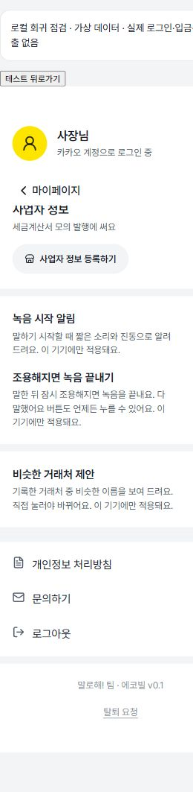
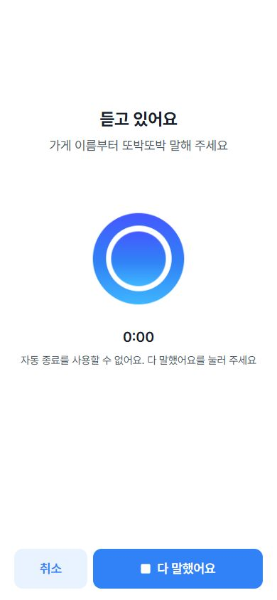

# 10/21 FE 후속 구현과 확인 자료

최근 PM 지시의 후속 작업이다. 기존 #178의 main 반영·경과일·현금 건수·외상 복사 연결 위에 추가한다. BE·DB·API 계약·새 의존성 변경은 없다.

## 구현

- **조용해지면 녹음 끝내기:** 마이페이지에서 명시적으로 켠 기기에서만 적용한다. 기본 꺼짐. 최소 300ms 말소리가 관측된 뒤, 최소 4초 녹음·3초 무음일 때 기존 수동 종료와 같은 경로로 후보를 만든다. 장부 확정은 사용자가 한다. RMS 0.02와 시간은 실기기 조정 전 임시값이다.
- 최초 무음·짧은 잡음은 종료하지 않는다. 분석 차단·중단·미지원은 수동 종료 안내로 전환한다. 취소·화면 이탈·언마운트에서 분석 타이머·AudioContext·마이크를 정리한다. 기존 30초 제한은 유지하며 음성 되묻기에는 적용하지 않는다.
- 실제 세금계산서와 미리보기의 거래 월을 공통 컴포넌트로 맞췄다. 미리보기의 월·상태 초기화와 장부/세금계산서 하단 탭 높이를 보완했다.
- 저장 전 서버 400 보완은 실제 RepairDialog로 따로 미리 본다: `/design?screen=clarify`. 닫기/완료 뒤 홈으로 돌아간다.

## 검증

- 전체 FE 테스트 **184/184**, lint·프로덕션 build·API 생성 타입 대조 통과.
- knip 미사용 항목 없음, jscpd 정확 중복 0, Git 미해결 항목·diff 공백 오류 없음.
- 별도 Claude 읽기 전용 코드/보안 리뷰 2회에서 차단 항목 없음. 리뷰에서 제안한 취소 타이머 정리·음성 답 분석 제외 테스트·미리보기 월/닫기 동작을 보완하고 재검증했다. 리뷰어가 테스트를 실행한 것은 아니다.
- 390×844의 화면 8쌍 비교: [비교 HTML과 이미지](qa-2026-10-21/comparison.html). 로그인·가입 완료·홈·확인·400 보완·장부·입금·세금계산서를 비교했다. 가상 API와 합성 데이터를 쓰며 내용·기록 수·선택 날짜는 다르므로 픽셀 일치나 운영 연동 결과는 아니다. 가입 완료는 공용 WelcomeView fixture다.
- 320×568에서 홈·확인·세금계산서와 세금계산서 미리보기의 가로 넘침 없음, 헤더 행 48px·하단 탭 bottom=568 확인. [측정값](qa-2026-10-21/narrow.json).
- 브라우저에서 설정 켜기, 분석 불가 안내, 녹음 수동 취소, 실제 400 보완, 미리보기 월/닫기 동작을 확인했고 해당 조작 중 JS error 로그는 없었다.
- JS gzip: 기존 #178 146.81kB → 후속 147.68kB. 번들 크기이며 모바일 Lighthouse/실기기 속도 결과는 아니다.

## 실기기 확인 준비

개발 서버에서 `/tests/device-capabilities.html`을 열면 실험 G의 API 존재 여부·한국어 기기 내 받아쓰기 상태·WebGPU 어댑터를 확인할 수 있다. 녹음·음성 전송·언어팩 설치·모델 다운로드는 하지 않는다. 운영 빌드에는 포함되지 않으므로 휴대폰에서 쓰려면 별도 HTTPS QA 환경이 필요하다. [SpeechRecognition.available](https://developer.mozilla.org/en-US/docs/Web/API/SpeechRecognition/available_static), [GPU.requestAdapter](https://developer.mozilla.org/en-US/docs/Web/API/GPU/requestAdapter).

PC 인앱 브라우저 점검은 한국어 기기 내 받아쓰기 `unavailable`, WebGPU `adapter-available`이었다. 휴대폰·카톡 결과로 쓰지 않는다.

[결과 CSV 양식](qa-2026-10-21/device-results-template.csv)은 헤더만 준비했다. 병철님의 동일 문장 세트 ID/버전과 수경님의 공통 판정 양식으로 측정한다. 기기·OS·카톡·빌드 SHA·반복·기능 켜짐 상태, 거래처/총액/필수 필드 일치, 신호 종료→후보 표시 시간, 말 잘림 여부를 기록한다. 결과표에 실제 고객 이름·원음·토큰은 넣지 않는다.

10/23 음성 측정 때 아이폰·갤럭시 카톡에서 키보드·안전 영역·복사/차단 시 선택·권한/잠금 복귀·느린 말/중간 쉼/시장 소음을 함께 확인한다. 실제 문장 세트와 실기기 결과는 아직 없다. `대파 3단 5000원` 총액 해석은 PM 지정 별도 확인 사례다.

## 남은 의존성

- 첫 사용 홈: 현재 ledger API는 month 생략 시에도 이번 달만 반환한다. 전체 기간 확정·미삭제 장부 존재 여부 계약이 있어야 신규/기존 사용자를 안전하게 구별할 수 있다.
- 기존 외상 옮기기: 거래처·남은 총액·이번 주/이번 달/지난달/그 전 UI만 있다. 10/23에 기준 날짜/FIFO·중복 입력·세금 Mock 제외·소유권·저장 API/멱등 재시도를 검토한 뒤 연결한다. 일반 매출로 위장해 저장하지 않는다.
- 모델 불일치/신뢰도 칸: 현재 응답에 신호가 없으므로 경로·수정 후 해제 계약이 필요하다. 거래처 제안의 점선·직접 수정은 이미 구현돼 있다.
- 거래처 제안: AI 담당의 실제 오인식/다른 가게 평가와 실기기 관문 전 기본 꺼짐을 유지한다. 세션 메모리 숫자 집계는 영구 수집 완료가 아니다.
- 모바일 Lighthouse 전후 측정과 실기기 정확도 측정은 미완료다.
